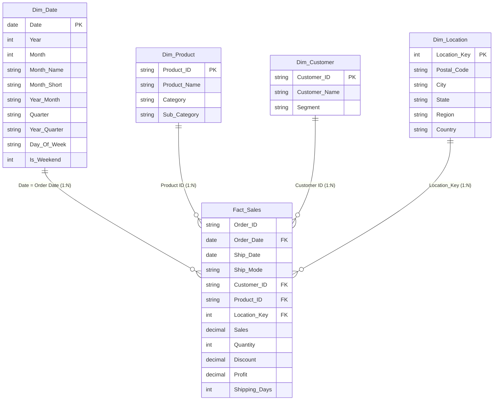

# Power BI Implementation & Management Decision Support Guide

## 1. Executive Summary & Purpose

This guide provides step-by-step technical instructions for building a production-grade, executive-ready Power BI dashboard using the cleaned Retail Superstore dataset. 

All source tables, star-schema relational models, DAX formulas, and visual layout specifications have been prepared and validated.

---

## 2. Data Architecture: Dimensional Star Schema

To optimize Power BI's VertiPaq columnar in-memory storage engine, we provide two ingestion options:

1. **Normalized Star Schema (Recommended):** Located in `powerbi/star_schema/` (Fact_Sales + 4 Dimensions).
2. **Single Denormalized Table:** Located in `data/processed/cleaned_superstore.csv`.

### Star Schema Entity-Relationship Model (ERD)

### Power BI Relationship Configurations

| From (Fact Table) | Column | To (Dimension Table) | Column | Cardinality | Cross Filter Direction |
| :--- | :--- | :--- | :--- | :--- | :--- |
| **Fact_Sales** | `Order Date` | **Dim_Date** | `Date` | Many to One (*:1) | Single |
| **Fact_Sales** | `Product ID` | **Dim_Product** | `Product ID` | Many to One (*:1) | Single |
| **Fact_Sales** | `Customer ID` | **Dim_Customer** | `Customer ID` | Many to One (*:1) | Single |
| **Fact_Sales** | `Location_Key` | **Dim_Location** | `Location_Key` | Many to One (*:1) | Single |

---

## 3. Power BI Desktop Step-by-Step Build Instructions

### Step 1: Ingest Data
1. Open **Power BI Desktop**.
2. Click **Get Data** -> **Text/CSV**.
3. Navigate to `powerbi/star_schema/` and select all 5 CSV files (`Fact_Sales.csv`, `Dim_Date.csv`, `Dim_Product.csv`, `Dim_Customer.csv`, `Dim_Location.csv`).
   *(Alternatively, select `data/processed/cleaned_superstore.csv` if building with a single flat table).*
4. In Power Query Editor, verify column headers and data types:
   - `Order Date`, `Ship Date`, `Date`: **Date**
   - `Sales`, `Profit`, `Discount`: **Decimal Number / Fixed Decimal (Currency)**
   - `Quantity`, `Shipping Days`, `Location_Key`: **Whole Number**
5. Click **Close & Apply**.

### Step 2: Establish Model Relationships
1. Switch to the **Model View** tab in Power BI.
2. Verify or create the 4 one-to-many relationships listed in Section 2 above.
3. Mark `Dim_Date` as the official **Date Table** (*Table Tools -> Mark as Date Table -> Date*).
4. Sort `Month_Short` by column `Month`, and `Quarter` by column `Quarter`.

### Step 3: Implement DAX Measures
Create a dedicated measures table:
1. In Home tab, click **Enter Data**, name the table `_Measures`, and click Load.
2. Right-click `_Measures` -> **New Measure**, and copy each DAX formula from [dax_measures.dax](file:///c:/Users/Shukla/OneDrive/Desktop/PROJECTS/DV/powerbi/dax_measures.dax).

**Key DAX Measures:**
- `Total Sales = SUM(Fact_Sales[Sales])`
- `Total Profit = SUM(Fact_Sales[Profit])`
- `Profit Margin % = DIVIDE([Total Profit], [Total Sales], 0)`
- `Total Orders = DISTINCTCOUNT(Fact_Sales[Order ID])`
- `Units Sold = SUM(Fact_Sales[Quantity])`
- `Average Order Value = DIVIDE([Total Sales], [Total Orders], 0)`
- `Sales Prior Year (PY) = CALCULATE([Total Sales], SAMEPERIODLASTYEAR('Dim_Date'[Date]))`
- `Sales YoY Growth % = DIVIDE([Total Sales] - [Sales Prior Year (PY)], [Sales Prior Year (PY)], 0)`

---

## 4. Visual Layout & Dashboard Pages

### Canvas Theme & Styling
- **Background:** White / Off-White (`#F8FAFC`)
- **Primary Navy:** `#0F172A`
- **Accent Blue:** `#1E40AF`
- **Teal Profit:** `#0D9488`
- **Rose Loss Indicator:** `#E11D48`
- **Font:** Segoe UI or Inter, 10pt labels, 20pt bold KPI values.

---

### Page 1: 🏛️ Executive Cockpit (16:9 Canvas)

1. **Top Slicer Bar (Y: 0, H: 60px):**
   - Date Range Slider (`Dim_Date[Date]`)
   - Region Slicer (Dropdown)
   - Category Slicer (Dropdown)
2. **Top KPI Cards (Row 1):**
   - Card 1: **Total Sales** with YoY Growth % delta.
   - Card 2: **Total Profit** with Profit Margin % subtitle.
   - Card 3: **Total Orders** (`DISTINCTCOUNT`).
   - Card 4: **Average Order Value (AOV)**.
   - Card 5: **Loss-Making Items Rate %** (Formatted in Rose red).
3. **Visual 1 (Line & Stacked Column Chart):**
   - X-axis: `Dim_Date[Year_Month]`
   - Column values: `[Total Sales]`
   - Line values: `[Total Profit]`
   - Title: *Monthly Sales & Profitability Growth Trend*
4. **Visual 2 (Clustered Bar Chart):**
   - Y-axis: `Dim_Product[Category]`
   - X-axis: `[Total Sales]` and `[Total Profit]`
   - Title: *Revenue & Profit Contribution by Category*
5. **Visual 3 (Filled Map / Shape Map):**
   - Location: `Dim_Location[State]`
   - Color Saturation: `[Total Profit]`
   - Tooltips: Sales, Profit, Margin %

---

### Page 2: 💰 Profitability & Discount Hazard Deep-Dive

1. **Scatter Plot (Discount vs. Profit):**
   - X-axis: `Fact_Sales[Discount]`
   - Y-axis: `Fact_Sales[Profit]`
   - Legend: `Dim_Product[Category]`
   - Size: `Fact_Sales[Sales]`
   - Reference Line: Y = 0 (Break-even threshold) and X = 0.20 (20% discount warning line).
2. **Horizontal Bar Chart (Sub-Category Loss Leaders):**
   - Y-axis: `Dim_Product[Sub_Category]`
   - X-axis: `[Total Profit]`
   - Conditional Formatting: Red for negative values, Teal for positive values.
   - Highlights the severe loss generated by Tables and Supplies.
3. **Decomposition Tree (AI Root-Cause Exploration):**
   - Analyze: `[Total Profit]`
   - Explain By: `Category` -> `Sub_Category` -> `Discount Band` -> `Region`.
   - Allows executives to interactively drill down into why profits collapse.

---

### Page 3: 🗺️ Territory & Segment Analytics

1. **Matrix Grid (Region vs. Customer Segment):**
   - Rows: `Dim_Location[Region]`
   - Columns: `Dim_Customer[Segment]`
   - Values: `[Total Sales]`, `[Profit Margin %]`
   - Conditional background heat map on `[Profit Margin %]`.
2. **Top / Bottom Product Leaderboard (Table with Data Bars):**
   - Top 10 by Sales vs. Top 10 by Profit vs. Deepest Loss Products.
   - Drill-through target for product details.

---

## 5. Refresh & Maintenance Guide

1. **Local File Refresh:**
   - To refresh with updated transaction data, replace `data/processed/cleaned_superstore.csv` or the files in `powerbi/star_schema/`.
   - In Power BI Desktop, click **Refresh** on the Home tab.
2. **Scheduled Refresh in Power BI Service:**
   - Publish report to Power BI Workspace (*File -> Publish -> Publish to Power BI*).
   - Configure **On-Premises Data Gateway (Personal or Enterprise Mode)** pointing to the project data directory.
   - Set daily scheduled refresh at 06:00 AM.
3. **Data Export:**
   - Any visual in Power BI allows exporting underlying summarized data to Excel or CSV via the visual header ellipsis (`...` -> *Export data*).

---

## 6. Deliverable Status Note

Power BI Desktop files (`.pbix`) require proprietary desktop runtime installation to serialize compiled report models. This repository provides:
- The verified clean transaction data (`data/processed/cleaned_superstore.csv`).
- The 5 star-schema table CSVs (`powerbi/star_schema/`).
- The complete DAX measure code (`powerbi/dax_measures.dax`).
- The complete visual specifications above for 1-click recreation.
